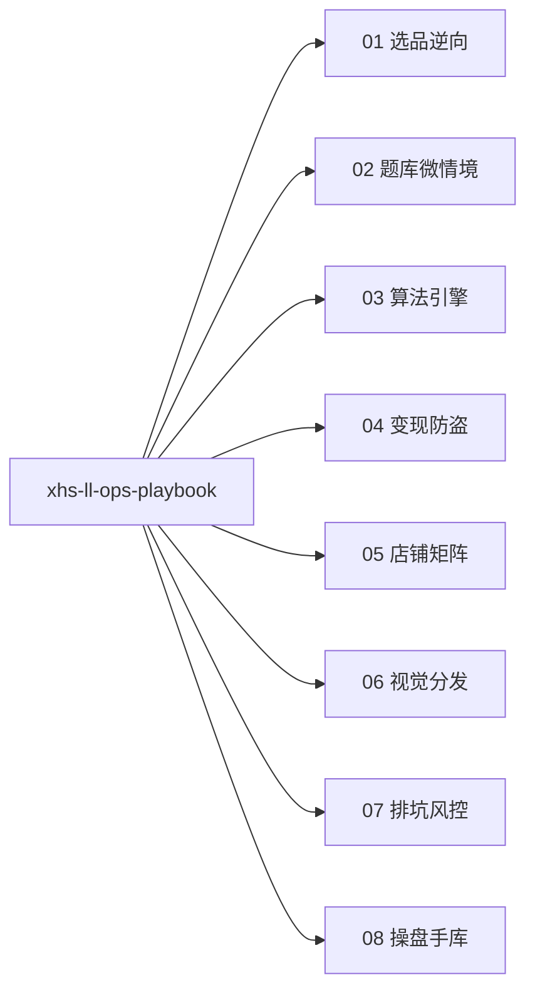

# 小红书老罗与操盘手实战宝典 (XHS LL Ops Playbook)

本技能为小红书虚拟测试矩阵的单一事实知识策略中枢 (SSOT)，深度整合老罗工业矩阵流与为为（小满）单品打穿流实战经验。采用渐进式披露机制，主文件只提供路由指针与执行审查门禁，具体操作细节按需查阅对应分册。

## 一、 业务场景路由与交付指针 (Progressive Disclosure)

严格按需查阅单个 reference 模块，保持上下文高信噪比：

| 业务场景 / 用户意图 | 分册指针 | 核心交付目标 |
| :--- | :--- | :--- |
| **选品立项 / 爆款逆向** | [`references/01_选品与爆款逆向.md`](references/01_选品与爆款逆向.md) | 选定高潜力轻趣味选题，输出百万级爆款对标来源与拆解方案 |
| **题库起草 / 85%+完答** | [`references/02_题库模型与微情境.md`](references/02_题库模型与微情境.md) | 输出 12~15 题四向本能微情境题库模型，保障完答率 |
| **算法引擎 / 防雷同设计** | [`references/03_算法引擎与防雷同.md`](references/03_算法引擎与防雷同.md) 实操工具：[`scripts/scoring_engine.ts`](scripts/scoring_engine.ts) | 交付双标签加权计分、压轴逆序仲裁及阶梯噪点实现代码 |
| **变现卡点 / 防盗验证** | [`references/04_商业变现与防盗系统.md`](references/04_商业变现与防盗系统.md) | 落地双梯队价格锚定、真实高斯模糊遮罩与单单 3 设备防盗闭环 |
| **店铺矩阵 / 自动履约** | [`references/05_店铺矩阵与自动履约.md`](references/05_店铺矩阵与自动履约.md) | 完成合规类目挂靠、蜂窝网络隔离配置与阿奇索秒级自动发货 |
| **视觉物料 / 封面排版** | [`references/06_视觉物料与工业化分发.md`](references/06_视觉物料与工业化分发.md) | 建立 50 张素材库，交付长短节奏封面、实况图与置顶评论引导 |
| **低转化排查 / 客诉急救** | [`references/07_低转化排查与客诉风控.md`](references/07_低转化排查与客诉风控.md) | 按照 5 步法定位诊断死因，执行流量急救与万能单号秒级安抚 |
| **经验沉淀 / 新打法接入** | [`references/08_操盘手案例与新打法库.md`](references/08_操盘手案例与新打法库.md) | 对比操盘流派，将新打法按照标准模版提炼归仓并融入对应流水线 |

---

## 二、 Agent 执行诊断门禁 (Actionable Verification Gates)

Agent 在执行各场景方案设计、代码实现或运营审查时，必须逐项核对对应标准门禁：

### 1. 选品立项审查门禁
- [ ] **题材合规性**：聚焦轻趣味、人设化、社交反差与亲密关系题材，避开医疗健康、心理障碍诊断及学术量表（如 SCL-90、SDS、SAS）。
- [ ] **数据验证源**：对标源具备坚实公域验证，优先选择播放量 ≥ 100 万且弹幕量 ≥ 1 万的成熟互动视频或热门选题。
- [ ] **社交货币度**：完整符合爆款潜力公式（强好奇窥探 + 强嘴替共鸣 + 强炫耀分享欲）。
- [ ] **商业承载力**：选题可顺畅拆解为 5~8 维丰富雷达图与多档位结果，适配 1.98~9.9 元低门槛静默决策。

### 2. 题库合格 4 项标准 (Question Bank Gate)
- [ ] **标准 1 · 题量与时长**：题目总量严格锁定为 12~15 题，单题作答时长 8~10 秒，全卷完答时长收敛在 2.5 分钟以内。
- [ ] **标准 2 · 微情境题干**：全量采用带有生活尴尬、人际冲突或利益取舍的戏剧微情境镜头，杜绝抽象自评与道德说教。
- [ ] **标准 3 · 四向本能对齐**：每题固定 4 选项，无道德高下之分，精准映射生物四向本能（Fight 抗争 / Flight 抽离 / Freeze 防御 / Fawn 迎合）。
- [ ] **标准 4 · 排版与自动切题**：各选项字数齐整保持在 12~16 字并采用主动行为动词；交互实现用户点击选项后 300ms 自动平滑滚动切题。

### 3. 算法算分与防雷同门禁 (Scoring Engine Gate)
- [ ] **双标签非对称加权**：每个选项均绑定主维度（+2 分）与副维度（+1 分），通过立体矩阵交叉赋分防止用户直觉猜题。
- [ ] **压轴决胜断平机制**：最高分出现平局时，按逆序检查压轴决胜题（第 15、14、10 题）仲裁排序，或打上稀有复合态标识。
- [ ] **自然阶梯噪点注入**：主维度锁定 100%，其余副维度在归一化后注入 ±5%~15% 离散随机噪点（步长整除 5），确保同测雷达图呈现专属差异。
- [ ] **标准接口规范对齐**：代码实现与输入输出结构必须严格与 `scripts/scoring_engine.ts` 标准算法逻辑保持一致。

### 4. 商业变现与防盗门禁 (Paywall & Anti-Theft Gate)
- [ ] **黄金拦截时机**：答题结束展现 1.5 秒动态 loading 动画，于好奇心峰值瞬间自然切入卡点。
- [ ] **真实模糊遮罩**：免费层仅展示主称号与简评，雷达图与深度解析必须采用 CSS `filter: blur(8px)` 真实毛玻璃遮罩，保留真实图表排版轮廓。
- [ ] **3 设备防盗闭环**：单订单号绑定上限严格设为 3 台设备，基于指纹与本地持久化放行买家及亲密好友，杜绝群聊公开扩散。
- [ ] **万能单号保底**：系统内置最高优先级的后台万能订单号，命中即无条件放行，作为客诉应急的极速安抚后门。

### 5. 店铺矩阵与履约配置门禁 (Store & Fulfillment Gate)
- [ ] **类目合规挂靠**：必须挂靠“教育培训-职业技能培训-个人兴趣培训”或“本地生活-充值/兑换卡-学习卡”等合规虚拟类目。
- [ ] **蜂窝网络物理隔离**：矩阵各账号必须使用独立设备并全程通过手机 SIM 卡蜂窝移动数据发布与运营，规避局域网批量营销判定。
- [ ] **全自动履约闭环**：千帆授权阿奇索插件对接卡密库，买家下单后 1 秒内通过千帆客服自动推送卡密与测试链接。
- [ ] **一主三辅矩阵架构**：以 1 个已认证主店（开店+发货）带动 3 个辅号（千帆绑定主店商品挂车引流）。

### 6. 视觉物料与分发门禁 (Visual Assets Gate)
- [ ] **素材中心工业化**：单款测试预制 50 张高清结果图素材库，搭配 3~5 组高点击标题库与去 AI 感真人叙事文案。
- [ ] **长短呼吸感排版**：封面文案采用“长句(8~10字) - 短句(2~4字) - 长句(8~10字) - 短句(2~4字)”交错排版，总字数严格控制在 16 字以内。
- [ ] **实况照片防摩尔纹**：真机屏幕拍摄必须采用 iPhone Live Photo（实况照片）模式拍摄与发布，彻底消除屏幕彩虹摩尔纹。
- [ ] **社交证明与首评截流**：H5 首页展示心跳同测在线人数（如“382人正在同测”），发帖后作者第一时间置顶购买引导首评。

### 7. 低转化诊断 5 步法 (Low-Conversion Diagnosis Gate)
- [ ] **第 1 步 · 封面视觉排查**：检查核心标题字数是否 ≤ 16 字，排版是否具备长短呼吸感与清爽插画/极简反差配图。
- [ ] **第 2 步 · 心理钩子核验**：检查笔记首图与文案前 3 秒是否精准击中“冒犯反差、社交防御、精准人设”三大心理钩子之一。
- [ ] **第 3 步 · 货品一致性检查**：检查笔记图文与挂载测试商品是否高度统一（笔记首图即测试前 3 道真题）。
- [ ] **第 4 步 · 评论截流闭环**：核验作者置顶评论是否提供明确路径（“测试同款在左下角/店铺”），引导下单即时获取报告。
- [ ] **第 5 步 · 流量风控与客诉响应**：排查违规词，受限笔记设置为仅自己可见并通过蜂窝流量正常交互测试推荐池；客诉遇情绪急躁买家立即秒发万能单号保店铺绿分。

### 8. 操盘手经验接入门禁 (Practitioner Intake Gate)
- [ ] **标准化模版归仓**：新案例完整包含操盘背景与数据、选品题库、转化卡点、矩阵流量、排坑心得 5 项标准维度。
- [ ] **知识流融合落地**：将新经验中的可复用策略拆解沉淀至对应的 `01`~`07` 业务流水线模块，保持单一真源。
- [ ] **中枢轻量化保障**：主技能文件严格仅保留索引指针与审查门禁，保持高信噪比与极低上下文开销。
