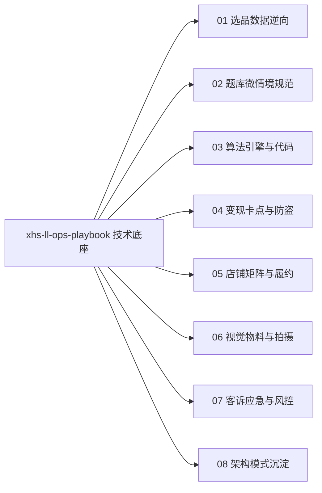

# 小红书虚拟测试工程实战宝典 (XHS Technical SSOT)

本技能为小红书虚拟测试落地实现的**单一技术真源 (SSOT)**。专职负责测试产品的**题库模型规范、双标签算分引擎、高斯模糊遮罩、3 设备防盗闭环、千帆阿奇索自动化履约与真机拍摄参数**。

> 💡 **职责边界**：
> - 宏观战略决策、立项多维裁决、双位文案互补审查与长尾漏斗归因 ➔ 统一由战略中枢 [`xhs-ops-council`](../xhs-ops-council/SKILL.md) 裁决；
> - 题库 Schema、代码算法、防盗参数与履约配置 ➔ 严格以本手册为单一技术真源。

---

## 一、 业务技术分册路由 (Progressive Disclosure)

严格按需查阅单个 reference 分册，保持上下文高信噪比：

| 技术场景 / 工程任务 | 分册指针 | 核心工程交付物 |
| :--- | :--- | :--- |
| **选品数据源 / 爆款逆向** | [`references/01_选品与爆款逆向.md`](references/01_选品与爆款逆向.md) | B 站百万播放互动视频逆向模型与轻趣味数据池 |
| **题库 Schema / 85%+完答** | [`references/02_题库模型与微情境.md`](references/02_题库模型与微情境.md) | 12~15 题四向本能微情境题库 JSON Schema 与作答时延规范 |
| **算法引擎 / 防雷同设计** | [`references/03_算法引擎与防雷同.md`](references/03_算法引擎与防雷同.md) 实操代码：[`scripts/scoring_engine.ts`](scripts/scoring_engine.ts) | 双标签非对称加权计分、压轴逆序仲裁及阶梯噪点 TypeScript 代码 |
| **变现卡点 / 真实模糊遮罩** | [`references/04_商业变现与防盗系统.md`](references/04_商业变现与防盗系统.md) | 1.5s 动态 loading、CSS `filter: blur(8px)` 遮罩与单单 3 设备防盗验证 |
| **店铺矩阵 / 自动履约配置** | [`references/05_店铺矩阵与自动履约.md`](references/05_店铺矩阵与自动履约.md) | 合规类目挂靠（【虚拟定制】）、蜂窝网络隔离配置与阿奇索千帆秒级发货 |
| **视觉物料 / 真机实况拍摄** | [`references/06_视觉物料与工业化分发.md`](references/06_视觉物料与工业化分发.md) | 50 张素材库规范、iPhone Live Photo 防摩尔纹与长短交错排版参数 |
| **客诉应急 / 流量急救** | [`references/07_低转化排查与客诉风控.md`](references/07_低转化排查与客诉风控.md) | 万能单号后台秒级放行后门与店铺评分绿分保全 SOP |
| **技术架构 / 操盘模式沉淀** | [`references/08_操盘手案例与新打法库.md`](references/08_操盘手案例与新打法库.md) | 工业矩阵流与单爆品精细流的工程架构沉淀 |

---

## 二、 工程执行二元门禁 (Binary Verification Gates)

代码落地与工程配置必须逐项核对并确保 100% 达成绿标：

### 1. 题库模型合格门禁 (Question Bank Gate)
- [ ] **题量与耗时**：题目总量严格锁定为 12~15 题，单题作答 8~10 秒，全卷完答收敛在 2.5 分钟内；
- [ ] **微情境镜头**：全量采用带有生活尴尬、人际冲突或利益取舍的戏剧微情境镜头；
- [ ] **四向本能对齐**：每题固定 4 选项，精准映射生物四向本能（Fight 抗争 / Flight 抽离 / Freeze 防御 / Fawn 迎合）；
- [ ] **选项字数与动效**：各选项字数齐整保持在 12~16 字，点击后 300ms 自动平滑滚动切题。

### 2. 算法引擎与防雷同门禁 (Scoring Engine Gate)
- [ ] **双标签非对称加权**：每个选项均绑定主维度（+2 分）与副维度（+1 分）；
- [ ] **压轴决胜断平机制**：最高分出现平局时，按逆序检查压轴决胜题（第 15、14、10 题）仲裁排序；
- [ ] **自然阶梯噪点注入**：主维度锁定 100%，其余副维度注入 ±5%~15% 离散随机噪点（步长整除 5），同测雷达图呈现专属差异；
- [ ] **接口协议对齐**：输入输出结构严格与 [`scripts/scoring_engine.ts`](scripts/scoring_engine.ts) 保持一致。

### 3. 商业变现与防盗门禁 (Paywall & Anti-Theft Gate)
- [ ] **拦截时机**：答题结束展现 1.5 秒动态 loading 动画，于好奇心峰值瞬间切入卡点；
- [ ] **真实模糊遮罩**：免费层仅展示主称号与简评，雷达图与深度解析采用 CSS `filter: blur(8px)` 真实毛玻璃遮罩；
- [ ] **3 设备防盗闭环**：单订单号绑定上限严格设为 3 台设备，基于设备指纹与本地持久化放行；
- [ ] **万能应急单号**：系统内置最高优先级的后台万能订单号，命中即无条件放行，作为客诉应急极速安抚后门。

### 4. 店铺矩阵与履约配置门禁 (Store & Fulfillment Gate)
- [ ] **合规类目挂靠**：统一挂靠【艺术品及周边】→【艺术定制】→【虚拟定制】；
- [ ] **蜂窝物理隔离**：矩阵各账号使用独立设备并全程通过手机 SIM 卡蜂窝移动数据发布与交互；
- [ ] **全自动履约配置**：千帆授权阿奇索插件，买家下单后 1 秒内通过千帆客服自动推送卡密与 H5 测试链接；
- [ ] **1 主 3 辅架构**：1 个主店（开店+发货）关联 3 个辅号（千帆绑定主店商品挂车引流）。

### 5. 视觉物料与拍摄门禁 (Visual Assets Gate)
- [ ] **长短交错排版**：封面文案采用“长句(8~10字) - 短句(2~4字)”交错排版，总字数控制在 16 字内；
- [ ] **真机实况图防摩尔纹**：真机屏幕拍摄统一采用 iPhone Live Photo（实况照片）模式拍摄与导出；
- [ ] **动态心跳背书**：H5 首页展示“382人正在同测”动态心跳感人数。
