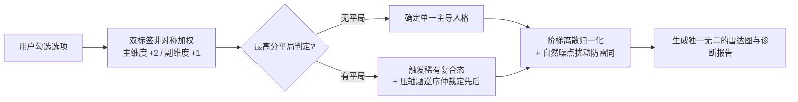

# 分册 03 · 算法引擎与防雷同 (Scoring Engine & Anti-Collision)

> **知识来源**：老罗头部爆款（ABO/甄嬛/变态测试）计分核心算法逆向  
> **核心职责**：指导选项维度的双标签非对称加权、平分决胜仲裁机制及自然防雷同算法代码。  
> **关联脚本**：可直接运行的 TypeScript 实现见 [`scripts/scoring_engine.ts`](../scripts/scoring_engine.ts)。

---

## 一、 算法核心机制概览

老罗爆款测试彻底摒弃了“单维线性累加（1~5分）”的初级逻辑，采用了三层精密算法：



---

## 二、 核心算法三要素解析

### 2.1 双标签非对称加权系统 (Dual-Tag Vector Weighting)
* **设计规则**：任何题目的每个选项，必须绑定两个性格维度 `[primaryDim, secondaryDim]`；
* **分值分配**：
  * 主维度：加 **2 分**（决定主香型 / 主性格）；
  * 副维度：加 **1 分**（决定底色 / 潜在人格）；
* **优势**：用户无法凭直觉操纵答案，各维度的交叉组合变化呈指数级丰富。

### 2.2 压轴决胜题仲裁 (Tie-Breaker) 与稀有复合态
当两个或多个维度得分相同（如 A 与 B 同为最高分）：
* **稀有复合态激活**：标记 `isCompound: true`，生成“双重觉醒/复合信息素”稀有结果（作为产品稀缺爆点）；
* **压轴仲裁题法则**：
  * **锁定第 15、14、10 题**（或最后 3 题）作为决胜仲裁题；
  * 按逆序检查用户在这些终极冲突题中的选项；
  * 用户优先命中的标签升为第一主维度，另一个降为第二副维度。

### 2.3 百分比离散归一化与防雷同扰动 (Noise Injection)
* **业务痛点**：闺蜜或情侣两人一起做测试，测出每项百分比分毫不差，会立刻引发“这测试是假的骗子”差评客诉与退款。
* **算法解法**：
  * 将主维度锁死为 100%；
  * 其余所有副维度在归一化后，注入 **±5%~15%** 的阶梯随机噪点（步长整除 5，避免出现负数或 0%）；
  * 确保两人即使主结果相同，雷达图的外观和副项排序依然各具特色。

---

## 三、 标准计分接口规范

可以直接在 H5 或 Next.js 项目中调用标准引擎：

```typescript
import { calculateTestResult } from '../scripts/scoring_engine';

// 传入用户答案、题库模型、所有维度列表、仲裁题索引
const result = calculateTestResult(
  userAnswers, // { 0: 'A', 1: 'C', ... }
  questions,   // 题目列表（含 options.tags [主, 副]）
  dimensions,  // ['掌控欲', '清醒度', '防御心', '内耗值']
  [14, 13, 9]  // 压轴决胜题索引 (第15, 14, 10题)
);

// 输出结构:
// {
//   scores: { 掌控欲: 18, 清醒度: 14, ... },
//   percentages: { 掌控欲: 100, 清醒度: 75, ... }, // 含自然噪点
//   primary: '掌控欲',
//   secondary: '清醒度',
//   isCompound: false
// }
```
完整源码请查阅 [`scripts/scoring_engine.ts`](../scripts/scoring_engine.ts)。
