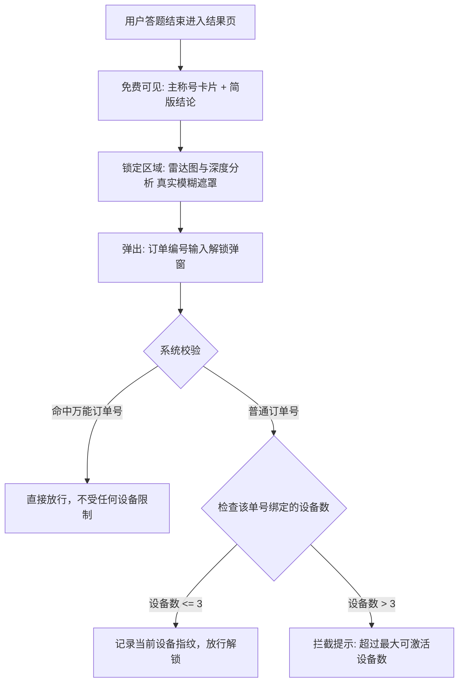

# 分册 04 · 商业变现与防盗系统 (Paywall & Anti-Theft Verification)

> **知识来源**：老罗双梯队变现卡点 + 操盘手为为（小满）三设备防白嫖验证系统  
> **核心职责**：指导 50 种高密度人设结果库搭建、双梯队套餐锚定、真实模糊遮罩卡点及单订单绑定 3 设备防白嫖闭环。

---

## 一、 结果库架构：从“6类大词”走向“50种极致人设”

### 1.1 传统测试痛点
传统心理测试只输出 4~6 种平淡大词（如“你属于回避型依恋”），缺乏辨识度与社交刺激，用户测完零分享欲。

### 1.2 50 种极致人设结果库构建
以《变态测试》、《ABO信息素》及《甄嬛传》为例，后台均预制海量梯队：
* **主轴分档 + 极致称号**：
  * 不是简单输出“2级”，而是输出 **“2级：阴影观察者”**、**“7级：复仇黑天鹅”**、**“9级：秩序崩坏者”**；
  * 《甄嬛传》输出 **“钮祜禄·甄嬛：纯元气场 运筹帷幄”**、**“年世兰：艳压后宫 霸气侧漏”**；
* **四维报告卡片结构**：
  1. **超大视觉封号**（攻击性金句，如“谁惹你谁倒霉”、“纯良外皮下的冷眼旁观”）；
  2. **多维雷达图**（5~6 个具体能力/欲望指标）；
  3. **外在人设 vs 真实内核** 对比切片（制造反差破防感）；
  4. **专属避坑盲区**（提供实用的防被吸血指南）。

---

## 二、 商业变现与卡点设计 (Paywall Architecture)

### 2.1 心理卡点拦截黄金时机
* 用户答完 15 题后，页面展示 **1.5 秒动态 loading 动画**（“AI 正在深度剖析您的 15 项潜意识抉择…”）；
* 动画结束，立即进入**核心报告锁点页面**，此时用户好奇心达到最高峰值，付费阻力最小。

### 2.2 双梯队套餐价格锚定 (Tiered Packages)
```text
┌───────────────────────────────────────────────┐
│              🔒 专属测试报告已生成             │
│                                               │
│  [🎁 裂变入口] 分享给朋友可免费解锁基础版       │
│                                               │
│  ┌─────────────────────────────────────────┐  │
│  │ 📦 方案一：深度解析【完整版】 (标准款)   │  │
│  │ • 维度深度分析 + 组合画像专属标签        │  │
│  │ • 外在人设与真实内核对照                │  │
│  │ • 社交模式深度解析 + 避坑盲区建议       │  │
│  │ [ 输入兑换码 ]   [ 立即解锁 ¥9.9 ]       │  │
│  └─────────────────────────────────────────┘  │
│                                               │
│  ┌─────────────────────────────────────────┐  │
│  │ ⭐ 方案二：深度解析【PRO版】 (利润款)    │  │
│  │ • 包含完整版全部权益                    │  │
│  │ • 显隐内核深度剖析 + 隐藏倾向 TOP3      │  │
│  │ • 7 天专属蜕变/觉醒成长路径指南         │  │
│  │ [ 立即解锁 ¥19.9 ]                       │  │
│  └─────────────────────────────────────────┘  │
└───────────────────────────────────────────────┘
```

---

## 三、 为为防白嫖订单验证系统（技术架构）

解决“一人购买全网免费分享”的虚拟测试毁灭性漏洞，打造交付级变现护城河。



### 3.1 真实模糊遮罩 UI (Blur UI)
- **绝对禁止**使用空白卡片、假锁图标或粗暴的大白块；
- **实现方案**：保留完整雷达图、文字解读的真实 HTML 结构排版，外层使用 CSS `filter: blur(8px)` + 半透明磨砂玻璃遮罩，中心悬浮文案：“【解锁后查看完整雷达图与深度解析】”。
- **心理学效应**：用户隐隐约约能看到自己专属的图表轮廓，好奇心被推到顶峰，极度愿意掏 1.98~9.9 元解锁。

### 3.2 单订单号激活 3 台设备（平衡体验与防刷）
- **为什么限制 3 台**：
  - 如果限制 1 台：用户换个浏览器或清理缓存就失效了，客诉差评爆炸；
  - 允许 3 台：刚好满足“买家自己测 + 顺手发给 1~2 个闺蜜测”的社交分享心理，用户觉得“物超所值”，好评率极高；
  - 同时有效封死“把链接丢进 500 人微信大群被几百人白嫖”的灾难。

### 3.3 万能订单号后门
- 管理后台支持配置 1~2 个万能订单号（如 `VIP888` 或指定长编码）；
- 拥有最高优先级，不计入普通单号设备统计，用于千帆智能客服快速秒回安抚暴躁用户。

---

## 四、 快速落地 AI Prompt 脚手架

需要将本系统在任何新 H5 测试项目中落地时，直接向 AI 投喂以下指令：

```markdown
请在当前测试项目中实现一套「结果页订单验证解锁系统」：
1. 结果页分级展示：顶部主称号卡片免费可见；自“短评”开始下方的雷达图与深度分析使用真实模糊遮罩（filter: blur(8px)）。
2. 解锁弹窗设计：文案为“一个订单编号可激活 3 台设备，你可以分享给 2 位朋友一起查看”，提供“验证订单编号”与“购买商品”入口。
3. 设备绑定逻辑：使用浏览器持久存储与设备指纹记录已绑定设备。单个订单编号最多绑定 3 台设备；当前设备已绑定过直接放行。
4. 万能订单号支持：支持配置后台万能码，命中立即无条件放行。
5. 保持整体设计质感与主题色协调，提供后台可清空重置设备记录入口。
```
