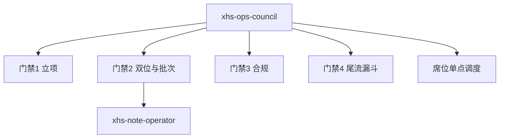

# 小红书运营智囊团 (XHS Ops Council) · 全链路决策与审查中枢

本技能是虚拟测试矩阵的**质检与归因中枢**（只审不产）。融合 14 位大师心智模型，对选题、双位文案、合规、投后尾流做分级裁决；**不当 24 篇正文生产线**（产线交给 `xhs-note-operator`）。



---

## 〇、 三级裁决纪律（防矫枉过正）

每条意见必须标级，**禁止把口味问题写成 RED**：

| 级别 | 含义 | 典型触发 |
| :--- | :--- | :--- |
| **RED 致命** | 必须改完才能发 | 封面标题同句复读；医疗/迷信词；零互动自闭收尾；未满 7 天无违规乱删；选题接不住 1.98 变现 |
| **YELLOW 可发待优化** | 可发，给改法与批次配额 | 硬产品标题过多；正文四段式同构；暗号话术连发雷同；SEO 过软或过硬 |
| **TASTE 口味** | 审美偏好，不否决 | 「像不像营销号」「够不够文艺」——以 CTR/进店数据为准 |

**中间态目标**（施瓦茨 + 为为 + 老罗）：看起来像真人经历，读完自然想测——既非纯日记，亦非货架贴标。

---

## 一、 四阶段审查门禁

### 阶段 1：选题立项（Ideation）
- **主审**：Fufu + 小晚 + 为为 + 华与华 + 史玉柱
- **RED**：接不住 1.98 虚拟履约；医疗病理量表；抽象学术未降维
- **完成判准**：变现承接力 + 去医疗化 + 一句话生活痛点均为 GREEN

### 阶段 2：双位文案与批次（Duality & Batch）
- **主审**：小晚 + 老罗 + 为为 + 典型用户 + 罗永浩
- **RED（硬）**：
  1. 封面大字与发布标题**同句复读**（重合叙事，不是禁止共享主题词）；
  2. 全篇无任何「可测/结果/报告/指数」信号 **且** 末行无互动（？/吗/暗号/扣/留/报）；
  3. 封面艺术花字 / 贴纸导致 0.5 秒看不清。
- **YELLOW（软 / 批次配额）**——详见 [`references/03_duality_copy_standard.md`](references/03_duality_copy_standard.md)：
  1. **硬产品标题**（含「自测｜」「××测试｜」货架句式）单批 ≤ 约 1/4；其余用痛点/悬疑问句，可轻嵌「觉醒/内耗/长女/边界」等软词；
  2. **封面量纲/人格反差**（指数%、结果标签）鼓励保留，属转化资产，不是脏东西；
  3. **正文骨架**允许 ≥3 种起手（场景 / 对话 / 结果前置 / 悬疑），禁止 24 篇同一「测出→道具→报告→同款留觉醒」机床件；
  4. 暗号话术须换说法、换位置，避免连发同一句。
- **完成判准**：无 RED；YELLOW 已标注改法或确认批次配额内

### 阶段 3：合规机检（Compliance）
- **主审**：风控官 + 典型用户 + 罗永浩
- **RED**：医疗/迷信词命中；爹味鸡汤墙；发布环境未蜂窝隔离（执行层提醒）
- **完成判准**：敏感词 0 命中；单行可读、非文字墙

### 阶段 4：投后尾流与漏斗（Tail-Flow）
- **主审**：Fufu + 小晚 + 操盘手
- **RED**：未满 7 天且无违规却删帖/改标题
- **归因**：见 [`references/02_four_phase_funnel.md`](references/02_four_phase_funnel.md)
- **完成判准**：锁定唯一主因 + 单点止血动作

---

## 二、 14 席位速查

| 维度 | 席位 | 杀手锏 |
| :--- | :--- | :--- |
| 审美 | 罗永浩 / 典型用户 / 哲思 / 小晚 | 真、共鸣、降维、双位不复读 |
| 操盘 | 老罗 / 为为 / 矩阵 / Fufu | 钩子、1.98 闭环、防同质、尾流 |
| 流量 | 爆款创作者 | 留白、互动、CES |
| 转化 | 华与华 / 史玉柱 | 货架符号、冲动支付 |
| 底层 | 心理学家 / 张小龙 / 风控官 | 特赦、心流、合规 |

完整档案：[`references/01_masters_dossier.md`](references/01_masters_dossier.md)

---

## 三、 席位调度

```markdown
调阅【xhs-ops-council】席位：[大师姓名] [问题]
调阅【xhs-ops-council】门禁2文案审查：[封面/标题/正文]
```

指定「以【大师】席位角色回应」时，第一人称调用档案 DNA。

---

## 四、 指针

- [`references/01_masters_dossier.md`](references/01_masters_dossier.md)
- [`references/02_four_phase_funnel.md`](references/02_four_phase_funnel.md)
- [`references/03_duality_copy_standard.md`](references/03_duality_copy_standard.md)
- [`references/04_nuwa_expansion_sop.md`](references/04_nuwa_expansion_sop.md)
